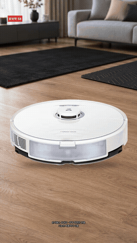
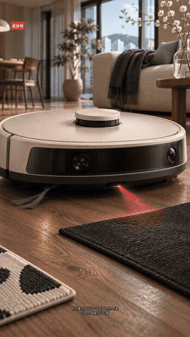

# 클리프 센서 v8.3 · 실사풍 A/B 테스트

- [A · 공식 S8 사진 합성](cliff-sensor-v83-realistic-A.mp4)
- [B · 일반형 로봇](cliff-sensor-v83-realistic-B.mp4)
- [A 구간별 대표 장면](contact-sheet-A.png) / [B 구간별 대표 장면](contact-sheet-B.png)
- [구간별 대표 장면 26장](representatives/)
- [공통 자막 SRT](subtitles-v83.srt) / [상세 사용량·검증 기록](production-metrics.json)

아래 GIF는 첫 10초의 저해상도 미리보기이며, 완성 MP4는 위 파일 링크입니다.

 

두 파일 모두 1080×1920, 24fps, 168초, 76컷(1.5~3초), 한국어 자막 106개입니다. 기존 v8.3 음성을 AAC 스트림 복사했으며, 두 영상 및 기존 영상의 디코딩된 음성 SHA-256이 일치합니다. 내레이션 문구를 변경하지 않았고, 자막의 모든 단어도 대본과 일치합니다.

## 제작 기록

| 항목 | A | B |
|---|---|---|
| 이번 이미지 생성 호출 | 새 배경 5회 + B 장면 18개 공유 | 24회: 기준 이미지 1 + 최종 장면 21 + 폐기·교체 2 |
| 제품 사진 | 로보락 공식 S8 PNG 4개 | 없음 |
| 토큰·유료 크레딧 | 모름: 도구에서 제공하지 않음 | 모름: 도구에서 제공하지 않음 |
| 시작~검수 완료(UTC) | 2026-11-04T05:32:49+00:00 ~ 2026-11-04T06:23:59.424687+00:00 | 동일 기간에 병행 |
| 총 경과 시간 | 약 51분 | 약 51분 |
| MP4 크기 | 32.7MB | 33.8MB |

공통 기획·소싱·공유 장면이 포함된 병행 작업 시간입니다. 두 시간을 더해 편당 원가로 계산할 수 없습니다. 음성은 새로 합성하지 않았습니다(이번 TTS 요청 0회). 재사용한 기존 음성은 ko-KR-SunHiNeural, 1회 요청, 공백 포함 1,720자였습니다. 그 합성의 토큰·실제 요금도 모릅니다. 이번 작업에서 결제나 크레딧 구매는 하지 않았습니다. 비용을 0원으로 확인한 것은 아닙니다.

사용 도구: image_gen.imagegen(하위 모델명 비공개), Python/Pillow, FFmpeg/libx264/libass, Git. 이미지 생성 호출은 중복 계산하지 않으면 총 29회입니다. 대화·추론 토큰과 도구의 청구량은 공개되지 않아 측정하지 못했습니다.

## 원본과 스타일 기준

사용자가 원본 ZIP과 CPU 레퍼런스를 보유하지 않아 웹 소싱을 허용했습니다. A에는 [로보락 한국 공식 S8 페이지](https://kr.roborock.com/pages/roborock-s8)의 제품 PNG 4개를 사용했습니다. 첨부했던 네 사진과 동일 파일은 아닙니다. 제품 픽셀은 AI로 다시 그리지 않았고 비례 확대·크롭·이동만 적용했습니다. 로고·색상에 별도 색 보정이나 형태 변형을 적용하지 않았습니다. 별도 접지 그림자를 합성했습니다. 원본 해시와 URL은 product-image-sources.json에 있습니다.

사용자 원본 CPU 영상과 동일한 레퍼런스를 확보했다고 주장하지 않습니다. 웹에서 구한 CPU 뚜껑 작업 매크로 사진(Мой Компьютер, Wikimedia Commons, CC BY 3.0)을 실사 질감·조명·심도 비교용 대체 기준으로 사용했습니다. 해당 사진 자체는 결과 영상에 넣지 않았습니다. B는 S8 사진을 참조하지 않고 별도의 일반형 기준 로봇 이미지를 각 장면 생성에 참조했습니다.

## 검수와 수정

두 영상 전체를 디코딩해 오류가 없는지 확인했고, 각 버전 76컷의 중간 프레임을 시간순으로 추출해 대체 CPU 레퍼런스와 나란히 비교했습니다. 이 검수는 프레임·타임코드·오디오 해시 검사이며, 사람이 실시간으로 전체 영상을 시청·청취한 검수와 같지는 않습니다. 자막 너비를 실제 글꼴로 검사했고 안전 너비 920px 안으로 맞췄습니다. 하단 고지와 4번 출처를 유지했습니다.

수정한 부분: 구멍으로 보이지 않던 러그의 로봇 시점 장면 재생성, 2002년 장면의 카메라 노출 제거를 위한 재생성, S8 합성의 사각 그림자를 부드러운 접지 그림자로 교체, 라이다 확대 구도 수정, 자막 줄바꿈 균형 조정, A 지도 화면의 금지구역·금지선 보강, 마지막 하부 확대 구도 수정.

## 남은 약점

A: 공식 제품 사진의 각도에 한계가 있어 모든 장면의 원근과 광원이 완전히 일치하지 않습니다. 원본 사진을 쓰는 일부 컷에서는 빨간 빔 모티프의 연결이 약합니다. 제품의 연속적인 실제 주행·회전 대신 사진 이동과 확대가 중심입니다.

B: 참조 이미지를 사용해도 장면별 하부 구조와 작은 부품은 조금씩 달라집니다. 연속 물리 애니메이션이 아니라 생성 이미지에 카메라 이동·확대를 적용한 편집입니다. 역사 장면은 실제 2002년 룸바 사진 재현이 아닌 일반형 연출입니다.

## 채널 톤 판단

채널의 고정 스타일로는 B를 권합니다. 제품과 배경의 질감·조명이 한 장면 안에서 자연스럽게 이어집니다. 브랜드를 바꿔도 같은 시각 언어를 유지하기 쉽습니다. A는 특정 제품을 보여 주는 협찬 제안용 테스트에 적합하지만 합성의 원근·동작 개선이 더 필요합니다.

이 파일은 테스트용이며 GitHub 게시에는 사용자가 명시적으로 동의했습니다. main에는 병합하지 않습니다.
